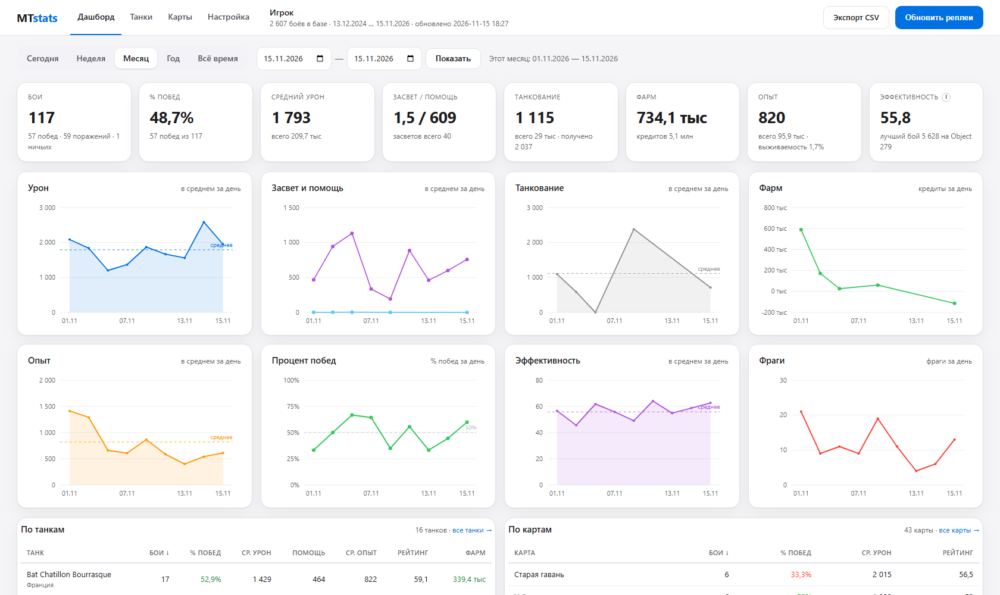

# MTstats

**Неофициальная фанатская программа** для статистики боёв «Мир танков» по файлам реплеев.

> ⚠️ **Тестовая версия 0.9.0.** Возможны ошибки и изменения.
> Программа **не связана с Lesta Games**, не одобрена и не поддерживается ею.
> «Мир танков» и связанные материалы принадлежат правообладателю.
> Распространяется бесплатно, **не для коммерческого использования**.

## Скачать

**[MTstats.exe — последняя версия](https://github.com/garrin33-a11y/mtstats/releases/tag/v0.9.0-beta)**
(Windows 10/11, около 30 МБ, установка не нужна).

Если Windows ругается на неизвестного издателя — «Подробнее» → «Выполнить в любом случае».



## Что умеет

- читает реплеи `.mtreplay` (и старые `.wotreplay`) из указанной папки;
- считает урон, засвет, помощь, танкование, фарм, опыт, фраги, % побед, выживаемость;
- строит графики за сегодня, неделю, месяц, год и всё время (точка — бой, день или неделя);
- показывает разрезы по танкам, картам и **респаунам** (верхний/нижний, левый/правый);
- считает **WN8** по ожидаемым значениям XVM, если они есть у вас на компьютере;
- выгружает все бои в CSV для Excel;
- работает полностью локально: без аккаунта, интернета и отправки данных.

## Установка (Windows 10/11)

1. Скачайте `MTstats.exe` из раздела **Releases**.
2. Положите файл в любую папку, например `C:\MTstats`.
3. Запустите двойным кликом.

Если SmartScreen предупреждает, что издатель неизвестен: **«Подробнее» → «Выполнить в любом случае»**
(файл не подписан сертификатом, это нормально для небольших открытых проектов).

Подробная пошаговая инструкция — [docs/ИНСТРУКЦИЯ.md](docs/ИНСТРУКЦИЯ.md).
Как выложить проект в открытый доступ — [docs/ПУБЛИКАЦИЯ.md](docs/ПУБЛИКАЦИЯ.md).

## Первый запуск

Откроется небольшое окно управления и браузер со статистикой.

- Если папка с реплеями нашлась автоматически (`C:\Games\Tanki\replays` и подобные) — сразу увидите бои.
- Если нет — откроется страница настройки: нажмите **«Обзор…»**, выберите папку с реплеями
  и нажмите **«Подключить»**. Первый импорт большой папки занимает до минуты.

В игре должна быть включена запись реплеев: **Настройки → Игра → Сохранять реплеи**.

## Как пользоваться

| Раздел | Что внутри |
|---|---|
| **Дашборд** | сводка за период: бои, % побед, урон, засвет, танкование, фарм, опыт, эффективность; 8 графиков, таблицы по танкам и картам, журнал боёв |
| **Танки** | таблица по всей технике: бои, победы, средний урон и опыт, фраги, выживаемость, точность, пробитие, отметка, мастерство; сортировка по любому столбцу, фильтры по уровню и классу |
| **Карты** | таблица по картам и отдельная страница каждой карты: мини-карта, графики, **статистика по респаунам**, танки на карте, журнал боёв |
| **Настройка** | папка с реплеями, обновление данных |
| **О программе** | версия, отказ от ответственности, лицензия |

Периоды переключаются вкладками **Сегодня / Неделя / Месяц / Год / Всё время** или своим диапазоном дат.
Значок **ⓘ** рядом с показателем объясняет, как он считается.

Кнопка **«Обновить реплеи»** дочитывает новые файлы без перезапуска программы.

## Как считается

- **Урон, засвет, помощь, танкование, опыт, фраги** — из блока результатов боя.
- **Помощь** = урон по вашей разведке + урон на гусеницах.
- **Фарм** — кредиты за вычетом ремонта, снарядов и снаряжения; на технике 10–11 уровня часто отрицательный.
- **% побед** — доля побед за период (ничьи отдельно).
- **Эффективность (0–100)** — собственный композитный рейтинг: 45% урон относительно своего запаса
  прочности (норма 1,6) + 20% фраги (3 = максимум) + 15% засвет и помощь (1500 = максимум) +
  10% танкование (1500 = максимум) + 10% победа.
- **WN8** — по стандартной формуле и ожидаемым значениям XVM.

## Что программа НЕ делает

- не изменяет клиент игры и не вмешивается в бой;
- не читает память игры и не даёт преимуществ — это не мод;
- не отправляет данные в интернет и не требует аккаунта.

## Где хранятся данные

`%APPDATA%\MTstats\`:

| Файл | Что это |
|---|---|
| `config.json` | папки с реплеями и настройки |
| `mtstats.db` | база боёв (около 2–3 МБ на 2 600 боёв) |
| `assets\` | справочники техники, карт и иконки, собранные из вашего клиента |
| `mtstats.log` | журнал работы и ошибок |

Удалить программу = удалить папку с exe и папку `%APPDATA%\MTstats`.

## Про файлы из игры

В комплект **не входят** картинки, справочники танков и карт: они собираются на вашем компьютере
из установленного клиента при первом запуске. Если клиент не найден, программа работает без иконок,
уровней и респаунов — просто показывает прочерки.

## Ограничения тестовой версии

- реплеи без блока результатов (старый формат, часть боёв 2024–2025) не читаются — они считаются
  в счётчике «не прочитано»;
- «Эффективность» — собственная формула, а не официальный рейтинг;
- поиск клиента проверяет стандартные пути (`C:\Games\Tanki` и т.п.); при нестандартной установке
  папку с реплеями нужно указать вручную;
- формат `.mtreplay` закрытый: после крупного патча игры чтение может временно сломаться.

## Сборка из исходников

Нужен Python 3.10+ (проверено на 3.12).

```bat
python -m mtstats serve            :: запуск из исходников
python build_exe.py                :: сборка dist\MTstats.exe (нужен pip install pyinstaller)
```

Зависимости для запуска: только стандартная библиотека Python. Для сборки exe и подготовки иконок
используется PyInstaller и Pillow.

## Лицензия

Код — MIT (см. [LICENSE](LICENSE)).

## Правовая информация

Игра «Мир танков», её файлы, изображения техники и карт являются собственностью правообладателя
(Lesta Games). В репозиторий и в собранную программу не входят игровые ресурсы: справочники и
картинки собираются на компьютере пользователя из его собственной установленной игры.

Проект неофициальный, не связан с Lesta Games, не одобрен и не поддерживается ею.
Проект распространяется бесплатно и не предназначен для коммерческого использования.
Программа не изменяет клиент игры, не читает память игры и не даёт преимуществ в бою.

WN8-значения берутся из кэша XVM на компьютере пользователя и в комплект не входят.
