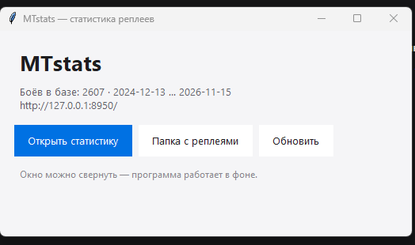
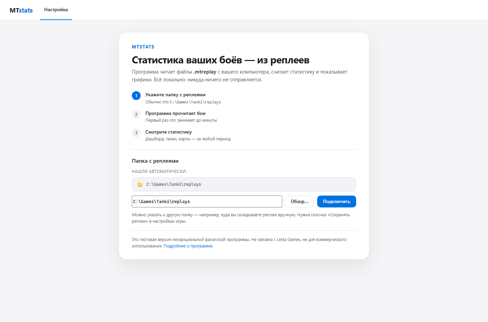
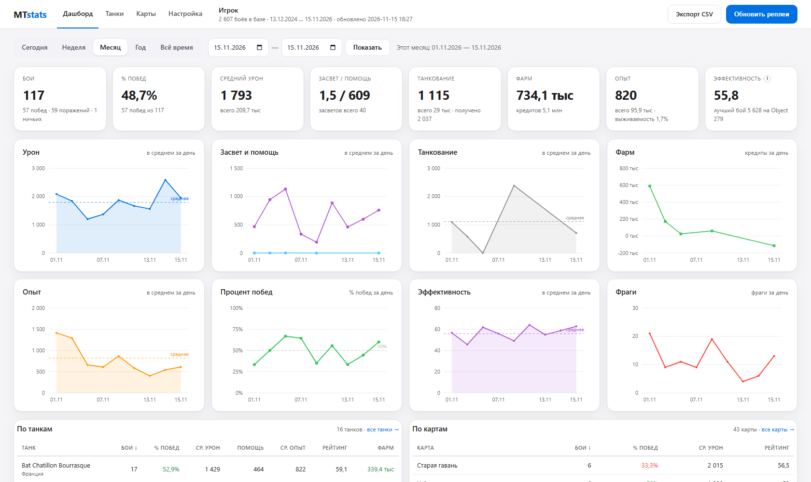
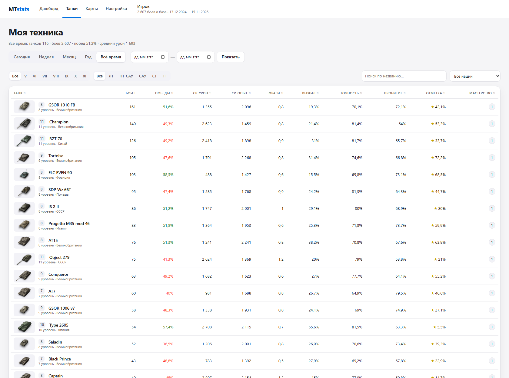
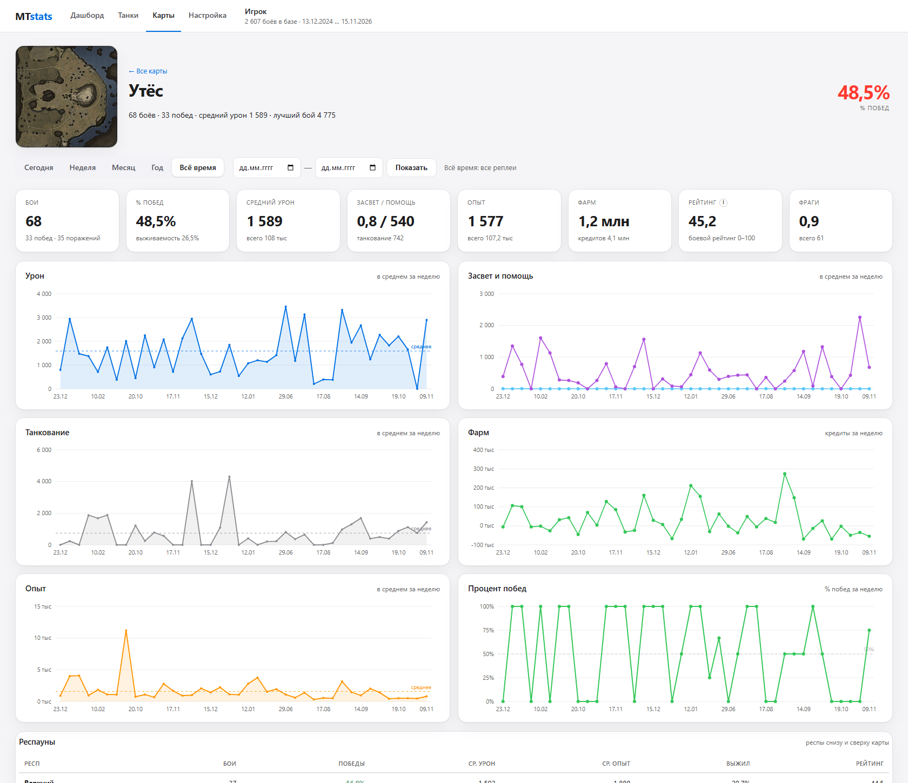

# MTstats — инструкция для чайников

Эта инструкция для тех, кто никогда не ставил такие программы. Всё, что нужно — уметь
скачать файл и нажать пару кнопок.

> ⚠️ **Важно.** MTstats — **неофициальная фанатская** программа. Она не связана с Lesta Games,
> не одобрена и не поддерживается ими. «Мир танков» и всё, что связано с игрой, принадлежит
> правообладателю. Программа бесплатная, **не для продажи**.
> Версия **тестовая** — возможны ошибки.

---

## Что понадобится

1. Компьютер с Windows 10 или 11.
2. Установленная игра «Мир танков».
3. Включённая запись реплеев: откройте игру → **Настройки → Игра → «Сохранять реплеи»** (галочка).
   Без неё новых файлов не будет, и статистика не пополнится.

---

## Шаг 1. Скачайте программу

Скачайте файл **`MTstats.exe`** (он весит около 30 МБ). Ничего устанавливать не нужно —
это один самодостаточный файл.

Создайте папку, например `C:\MTstats`, и положите файл туда.
Не запускайте программу прямо из архива или из загрузок «на один раз» — папка должна быть постоянной.

## Шаг 2. Запустите

Двойной клик по `MTstats.exe`.

Windows может показать синее окно **«Система Windows защитила ваш компьютер»** — это происходит
со всеми программами без платной цифровой подписи. Нажмите **«Подробнее»**, затем
**«Выполнить в любом случае»**.

## Шаг 3. Появится окно программы

Одновременно с окном откроется браузер со статистикой. Окно выглядит так:

В нём:

- строка **«Боёв в базе: …»** — сколько боёв уже прочитано;
- адрес `http://127.0.0.1:…` — по нему открывается статистика (открывается само);
- кнопки: **Открыть статистику**, **Папка с реплеями**, **Обновить**.

Окно можно свернуть — программа продолжает работать. Закрыли окно — программа закрылась.

## Шаг 4. Укажите папку с реплеями (только при первом запуске)

Если программа нашла папку с реплеями сама, вы сразу увидите дашборд — переходите к шагу 6.

Если папка не нашлась, в браузере откроется страница настройки:

1. Если в блоке **«Нашли автоматически»** есть папка — просто нажмите на неё.
2. Если нет — нажмите **«Обзор…»** и выберите папку, где лежат реплеи.
   Обычно это `C:\Games\Tanki\replays`.
3. Нажмите **«Подключить»**.

Программа начнёт читать файлы. На большой папке (2–3 тысячи реплеев) это занимает
до минуты. Когда закончит — сама откроет статистику.

> Если появилось сообщение «В этой папке не нашлось ни одного реплея» — проверьте, что вы выбрали
> именно папку `replays`, и что в игре включено сохранение реплеев.

## Шаг 5. Что вы увидите

Сверху — **карточки с главными цифрами** за выбранный период: бои, % побед, средний урон,
засвет и помощь, танкование, фарм, опыт, эффективность.

Ниже — **8 графиков**. Наведите мышку на точку — появится подсказка с датой и цифрами.

Ещё ниже — **таблицы по танкам и картам** и **журнал боёв** с результатом каждого боя.

## Шаг 6. Выберите период

Вкладки под шапкой:

- **Сегодня** — только сегодняшние бои (точка графика — каждый бой);
- **Неделя** и **Месяц** — точка графика — день;
- **Год** и **Всё время** — точка графика — неделя (иначе график превращается в кашу);
- **свой диапазон** — введите даты в два поля и нажмите **«Показать»**.

Адрес страницы запоминает период: можно сохранить ссылку в закладки.

## Шаг 7. Смотрите отдельные танки

Вкладка **«Танки»** — таблица всей техники, на которой вы играли:

- нажмите на заголовок столбца — таблица отсортируется (по умолчанию по числу боёв);
- фильтры сверху: уровень (римские цифры), класс (ТТ, СТ, ЛТ, ПТ-САУ, САУ), поиск по названию, нация;
- нажмите на строку танка — откроется его личная страница с графиками и журналом боёв.

## Шаг 8. Смотрите карты

Вкладка **«Карты»** — статистика по каждой карте. Нажмите на карту, чтобы открыть её страницу:
там мини-карта, графики, список танков и **статистика по респаунам** — с какого края вы
появлялись и как это влияло на результат.

## Шаг 9. Обновляйте данные

После новых боёв нажмите в окне программы **«Обновить»** или на дашборде — **«Обновить реплеи»**.
Новые файлы дочитаются за пару секунд.

---

## Что означают цифры

| Показатель | Что это |
|---|---|
| **Урон** | сколько урона вы нанесли за бой |
| **Засвет** | сколько машин вы засветили |
| **Помощь** | урон союзников по вашей разведке и по вашим гусеницам |
| **Танкование** | сколько урона заблокировала ваша броня |
| **Фарм** | кредиты минус ремонт, снаряды и снаряжение. На 10–11 уровне часто минус |
| **Опыт** | опыт за бой (как в окне результатов) |
| **Фраги** | сколько машин уничтожили |
| **% побед** | доля побед за период |
| **Эффективность (0–100)** | составной рейтинг: 45% урон относительно своего запаса прочности, 20% фраги, 15% засвет и помощь, 10% танкование, 10% победа |
| **WN8** | стандартный рейтинг по ожидаемым значениям XVM (если XVM есть на компьютере) |

Возле показателя «Эффективность» есть значок **ⓘ** — наведите на него, чтобы увидеть формулу.

---

## Если что-то не работает

| Проблема | Что делать |
|---|---|
| Окно «Could not create temporary directory» | Скачайте **портативную версию** (`MTstats-portable.zip`), распакуйте в папку и запустите `MTstats-portable.exe`. Либо проверьте свободное место на диске `C:` и добавьте папку программы в исключения антивируса |
| Антивирус удаляет или блокирует exe | Добавьте папку программы в исключения. Файл не подписан, поэтому антивирус может ругаться на него |
| Новые бои не появляются | Включите «Сохранять реплеи» в настройках игры и нажмите «Обновить» |
| Не показываются иконки, уровни, респауны | Не найден клиент игры. Программа ищет `C:\Games\Tanki` и типовые пути; при нестандартной установке эти данные не собираются — остальная статистика работает |
| Пустые графики | За выбранный период нет боёв. Переключите период на «Всё время» |
| Статистика «не та» | Данные считаются по вашим реплеям; бои без файла реплея в статистику не попадают |
| Программа не запускается | Загляните в `%APPDATA%\MTstats\mtstats.log` — там записана причина |

---

## Как удалить программу

1. Закройте окно MTstats.
2. Удалите папку с `MTstats.exe`.
3. Удалите папку `%APPDATA%\MTstats` (там настройки и база боёв).

## Где лежат данные

Всё хранится только у вас: `%APPDATA%\MTstats\`. Программа **ничего не отправляет в интернет**
и не требует аккаунта.

## Ограничения тестовой версии

- старые реплеи без блока результатов (часть файлов 2024–2025 годов) не читаются — они считаются
  в счётчике «не прочитано»;
- «Эффективность» — собственная формула, а не официальный рейтинг игры;
- после крупных патчей игры формат реплеев может измениться, и чтение временно сломается —
  обновите программу.
